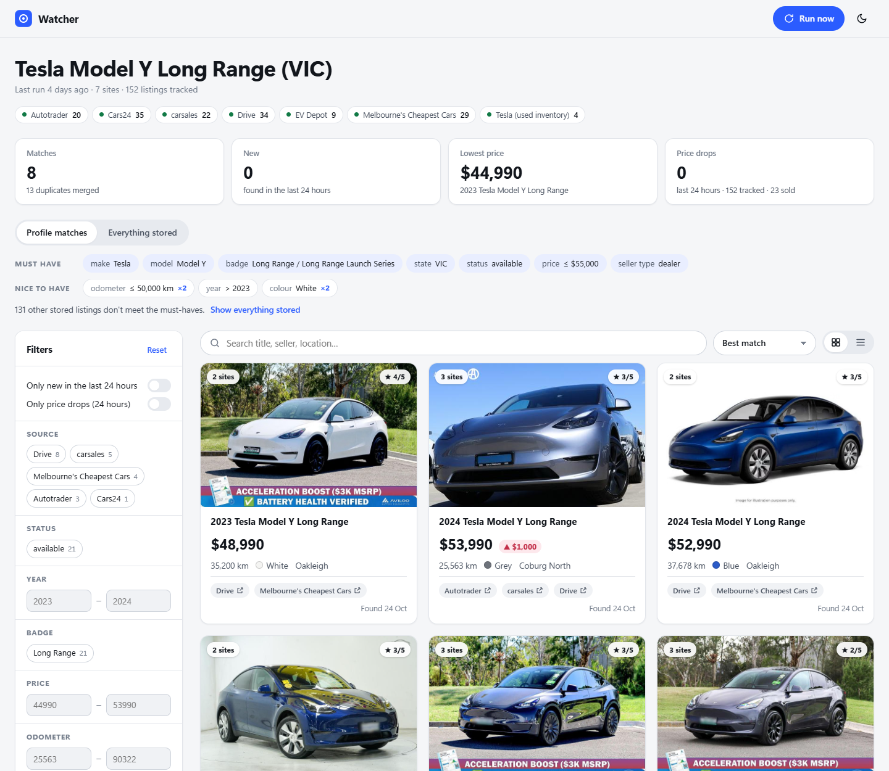
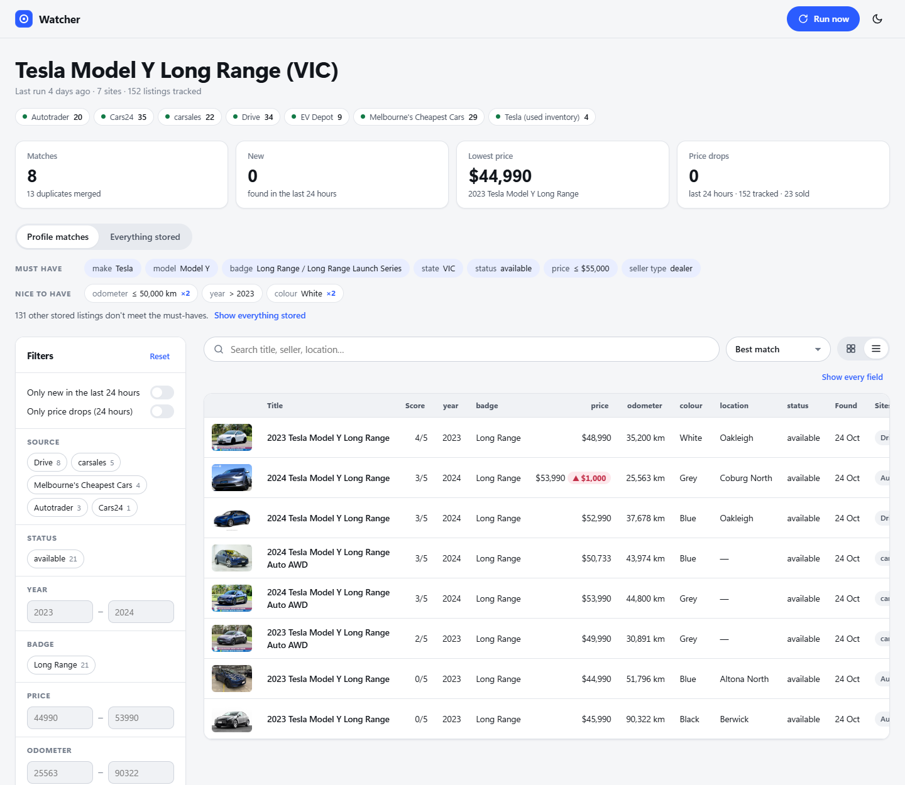
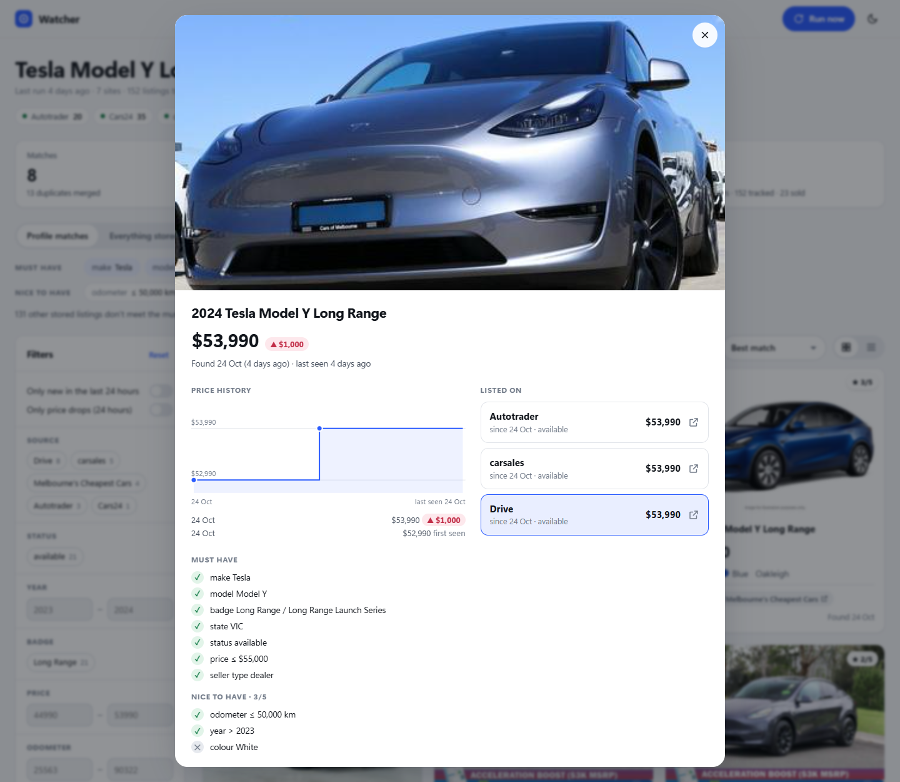
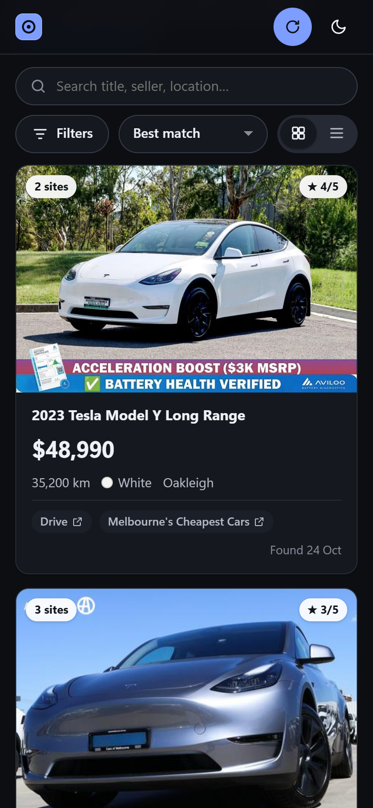
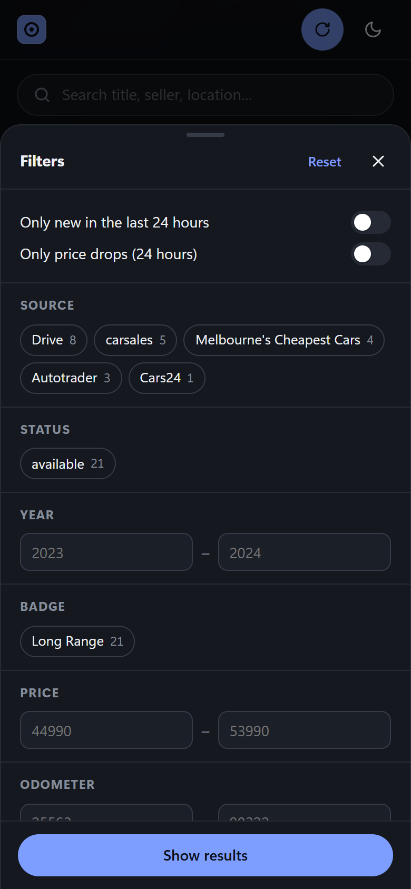
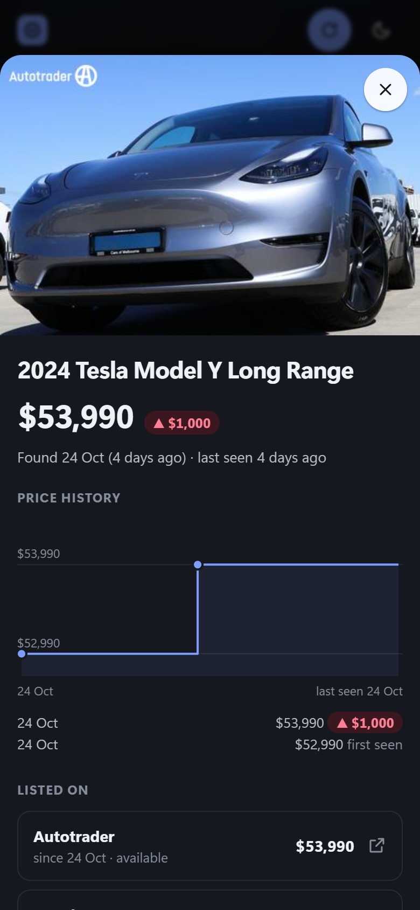

# Watcher

Watcher keeps an eye on car sale websites for you. You tell it what you're after, for example
a Tesla Model Y Long Range in Victoria under $55,000. It checks seven sites several times a day,
puts every match on one page and messages you on Facebook Messenger when a good one turns up.

It started as a used-car finder. The idea works for other things too.



## What it does

- **Searches several sites at once**: carsales, Drive, Autotrader, Cars24, Tesla's used
  inventory, EV Depot and Melbourne's Cheapest Cars.
- **Shows only the cars you want.** You choose the must-haves, like make, model, state and
  maximum price. Then you add some nice-to-haves, like low kilometres or a white car. The best
  matches come first.
- **Merges duplicates.** One car listed on three sites shows up once, with a link to each site.
- **Remembers everything.** It keeps track of when each car first appeared and how its price
  has changed, and notices when a car has sold.
- **Messages you.** You get a Messenger message when a new top match appears, plus a summary
  after each scheduled check.

## The web page

The web page is the main way to use Watcher. It works on a computer and on a phone.

### Matches

The home page shows the cars that meet all your must-haves, with the best matches first. The
pills at the top show how many cars each site returned on the last check. The tiles below them
show the number of matches, new cars, the lowest price and recent price drops. Tap a tile to
show just those cars.

Use the filters on the left to narrow things down, for example by year, price, kilometres,
colour or site. The filters only change what you see; they never change your search. Press
**Run now** to check every site straight away.

### Table view

Prefer a spreadsheet look? Switch to the table view with the button next to the sort menu.



### Everything stored

**Everything stored** shows every car Watcher has ever found, including sold cars and cars
that don't meet your must-haves. Each card says why a car missed out, for example
"make is Mazda, needs Tesla".

### Car details

Click a car to see its price history, every site it's listed on (with links) and how it
scores against each of your must-haves and nice-to-haves.



### On your phone

The page works on a phone too. The filters slide up from the bottom of the screen. Use the
moon button to switch between light and dark mode.

| Results | Filters | Car details |
| --- | --- | --- |
|  |  |  |

## Messenger

Watcher can message you on Facebook Messenger from a Facebook Page:

- **New top matches.** When a car scores full marks on your nice-to-haves, you get a message
  with the car's details and a link to every site it's on. Each car is announced only once.
- **Summaries.** After each scheduled check (6am, 9am, noon, 3pm and 6pm Melbourne time) you get a
  short summary: how many matches there are, how many are new, and how each site went.
- **Check now by message.** Send the page any message and Watcher checks every site straight
  away. It replies when it starts and sends the results when it's finished.

Facebook only lets a page message you within 24 hours of your last message to it. Reply to an
alert every so often to keep the messages coming.

To set it up, copy `.env.example` to `.env` and fill in two values:

1. `MESSENGER_PAGE_TOKEN`: create an app at developers.facebook.com, add Messenger, connect
   your Facebook Page and generate a Page access token.
2. `MESSENGER_RECIPIENT_ID`: message your page from your own Messenger account. Then run
   `python -m watcher notify ids` and copy your ID.

Then run `python -m watcher notify test` to check that a message arrives.

## Changing what it looks for

Each search is a short text file in the [profiles](profiles/) folder. The Tesla one is
[profiles/tesla-model-y-lr.yaml](profiles/tesla-model-y-lr.yaml). Open it to change the
must-haves (`required`), the nice-to-haves (`optional`) and when you get messaged (`notify`).
The web page picks up the changes the next time you refresh it.

## Where it runs

Watcher runs on the Unraid server at **http://192.168.0.2:8000**. Open that address on any
device connected to the home Wi-Fi. There's no login, so anyone on the network can see the
page and press Run now.

To send the latest committed code to the server, run `./deploy.ps1`. Changes to the profiles
need a deploy too.

## Running it on your own computer

Watcher needs Python and Google Chrome. Chrome is used to read Tesla's site.

```powershell
python -m venv .venv
.venv\Scripts\python -m pip install -r requirements.txt
.venv\Scripts\python -m watcher web
```

Then open the address it prints. Only run one copy with Messenger set up at a time. If two
copies are running, every message to the page starts two checks.

## Command line

The web page covers everyday use, but there are also a few commands you can run in a terminal:

| Command | What it does |
| --- | --- |
| `python -m watcher web` | Start the web page |
| `python -m watcher run profiles\tesla-model-y-lr.yaml` | Check every site now and print the results as a table |
| `python -m watcher db profiles\tesla-model-y-lr.yaml` | Apply your current rules to every car already found, without checking the sites |
| `python -m watcher sources` | List the sites it can search |
| `python -m watcher notify test` | Send a test Messenger message |

Add `--help` to any command to see its options.
